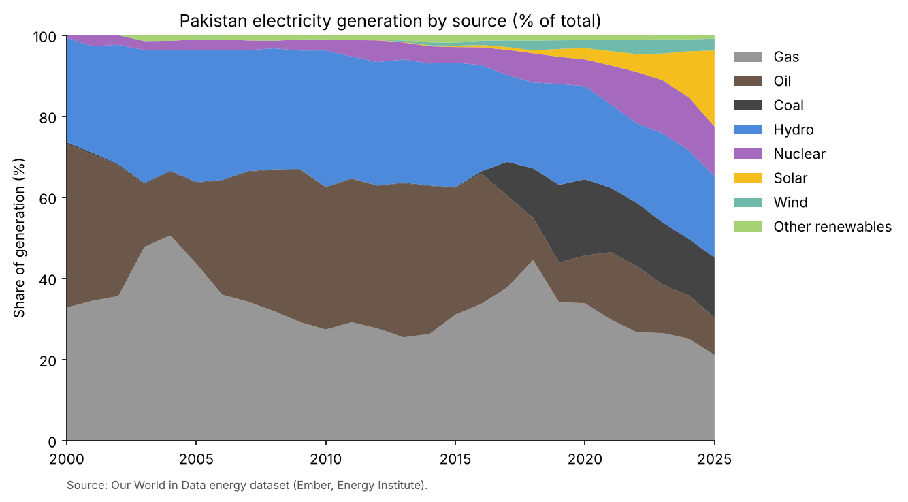
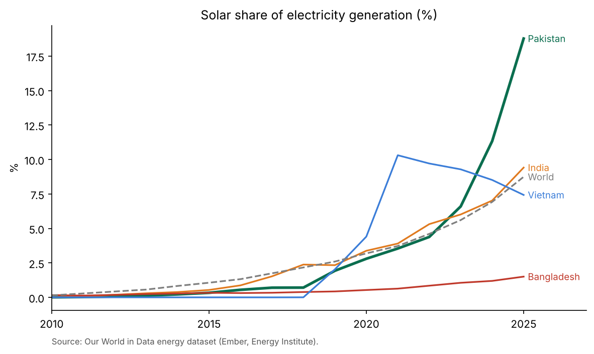

# Pakistan's Power-Sector Transition, 2000–2025

An open, reproducible analysis of how Pakistan's electricity mix has changed, with a focus on the rapid rise of solar since 2020 and what it means for fossil fuel dependence, emissions and access.

## Key findings

From `outputs/findings.md`, which is regenerated on every run:

- **Solar went from marginal to mainstream.** Solar's share of generation rose from 0.7% (2018) to 18.8% (2025), roughly double India (9.4%) and the global average (8.7%).
- **Solar output grew about ninefold**, from 4.1 TWh (2020) to 36.6 TWh (2025).
- **Fossil dependence fell.** Gas, oil and coal supplied 67.1% of generation in 2018 and 45.1% in 2025.
- **The grid is getting cleaner.** Carbon intensity fell from 486 to 347 gCO2/kWh (2017–2025), now below the world average of 458.
- **Access remains the core gap.** At 764 kWh per person, Pakistan generates about 20% of the world average and 54% of India's per capita.
- **The 2022–2025 shift was driven by solar** (+28.9 TWh), while oil-fired generation fell most (−10.7 TWh).




## Why it matters

Pakistan's recent solar growth is widely reported to be mostly distributed, behind-the-meter capacity, driven by rising grid tariffs and cheap imported panels. This repo does not test that directly. If it holds, it raises policy questions this repo is set up to explore:

1. **Utility finances.** Grid sales fall as consumers self-generate, while fixed capacity payments remain, which puts pressure on the circular debt.
2. **Equity.** Households that can afford rooftop solar leave the grid, and costs shift onto those who can't.
3. **Import bill.** Less oil- and LNG-fired generation reduces fuel import exposure.

## Repository structure

```
data/raw/            OWID energy dataset snapshot (unmodified)
src/analysis.py      Full pipeline: load → figures → tables → findings
outputs/figures/     5 charts (PNG)
outputs/tables/      Tidy CSVs behind each chart
outputs/findings.md  Auto-generated headline numbers
```

## Reproduce

```bash
pip install -r requirements.txt
python src/analysis.py
```

To refresh the data, replace `data/raw/owid-energy-data.csv` with the latest file from https://github.com/owid/energy-data.

## Data and caveats

- **Source:** [Our World in Data energy dataset](https://github.com/owid/energy-data), compiled from Ember and the Energy Institute Statistical Review. Snapshot downloaded October 2026.
- **Provisional data:** the latest years may be provisional or modelled.
- **Distributed solar is estimated.** Rooftop and off-grid solar output is not directly metered in Pakistan, so solar figures depend on Ember's modelling.
- **Per-capita measure:** "Per capita" is generation per person, not household consumption.

## Next steps

- Merge NEPRA/NTDC data on grid sales and capacity payments to quantify grid defection.
- Use HIES or PSLM microdata to examine who adopts solar, by income quintile and province.
- Join PBS trade data on solar panel imports, as a leading indicator of distributed capacity.

---
Author: Danyal Khattak · [github.com/danyalkhattak-git](https://github.com/danyalkhattak-git)
